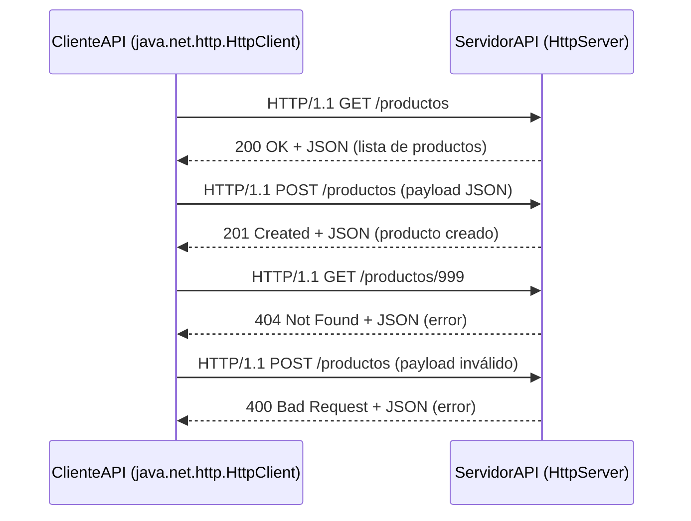
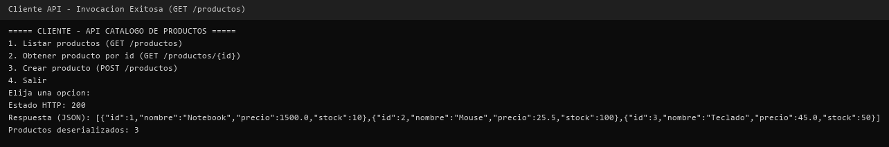
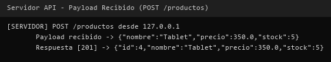
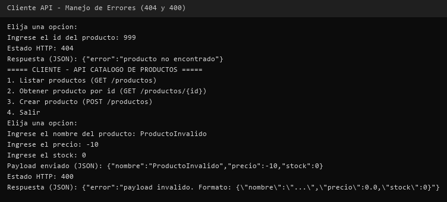

# Trabajo Práctico N° 7 — Integración entre Capas y Consumo de APIs / Servicios Distribuidos

## Carátula e Identificación

- **Alumno:** Ignacio Eduardo Nallar
- **Materia:** Desarrollo de Aplicaciones para Ambientes Distribuidos
- **Cátedra:** Lic. Gabriel Artaza
- **Lenguaje y frameworks:** Java (JDK 25) — API REST con `com.sun.net.httpserver.HttpServer` (servidor) y `java.net.http.HttpClient` (cliente), sin frameworks externos.

## Diagrama de Arquitectura

## Descripción del Servicio

API REST de **Catálogo de Productos** con los siguientes endpoints:

| Método | Ruta | Descripción | Códigos de estado |

GET -> `/productos` -> Lista todos los productos -> 200 
GET -> `/productos/{id}` -> Obtiene un producto por id -> 200, 404 
POST -> `/productos` -> Crea un producto (JSON) -> 201, 400 

El servidor registra en consola cada petición (método, ruta, host del cliente), la **carga útil recibida** y la **respuesta devuelta**, evidenciando el proceso de *marshalling/unmarshalling* del JSON en la capa de transporte.

## Evidencias de Ejecución

**Captura 1 — Invocación Exitosa:** petición `GET /productos` del cliente y respuesta correcta (200 + JSON) con deserialización de la lista:

**Captura 2 — Estructura de Datos (Payload):** detalle en la consola del servidor de la carga útil JSON recibida en el `POST /productos`:

**Captura 3 — Manejo de Errores:** respuesta `404 Not Found` ante un producto inexistente y `400 Bad Request` ante un payload inválido:

## Instrucciones de Ejecución

1. **Abrir terminal (Ctrl + Alt + Ñ)** y posicionarse en la carpeta `Desarrollo/TP_7`.
2. java servidor/ServidorAPI.java
3. **Abrir terminal (Ctrl + Alt + Ñ)**
4. java cliente/ClienteAPI.java
5. El cliente muestra un menú para listar, obtener y crear productos.
