# Desarrollo de Aplicaciones para Ambientes Distribuidos

**Profesor:** Lic. Gabriel Artaza
**Alumno:** Ignacio Eduardo Nallar

---

##  Descripción

En este repositorio se podrán encontrar todos los **trabajos prácticos realizados a lo largo de la cursada** de la materia *Desarrollo de Aplicaciones para Ambientes Distribuidos*.

###  Contenido

El repositorio contiene los diferentes trabajos prácticos, ejemplos, ejercicios y actividades desarrollados durante el trayecto de la cursada.

## Requisitos Previos

Antes de comenzar, asegúrate de tener instalado en tu sistema:
- **Git** (para clonar el repositorio).
- **Java Development Kit (JDK)** (versión 8 o superior, para compilar y ejecutar el código).

## Clonar repositorio

1. Abrir la terminal.
2. Posicionarse en la carpeta donde se desee clonar el repositorio (utilizando el comando cd <NOMBRE_DE_LA_CARPETA>).
3. Una vez posicionado en la carpeta deseada, colocar el siguiente comando:
git clone https://github.com/ignacionallar/distributed_environments_tps.git

TP 1 - Arquitectura Cliente-Servidor y Comunicación mediante Sockets TCP

## Instrucciones de ejecución

## Principal Folder: `Desarrollo/TP_1`

1. **Abrir terminal (Ctrl + Alt + Ñ)**
2. java ServidorCalculadora.java
3. **Abrir terminal (Ctrl + Alt + Ñ)**
4. java ClienteCalculadora.java

## Analisis Teorico-Practico
1. ¿Qué sucede con el cliente si el servidor no está ejecutándose al momento de
intentar conectar? Muestre la excepción que lanza Java.

    Si el servidor no está ejecutándose, no hay ningún proceso escuchando en el puerto 5500. El cliente intenta acceder, pero el sistema operativo local lo rechaza, lanzando la siguiente excepción:
    **java.net.ConnectException: Connection refused: connect**

3. Identifique en su código qué línea bloquea la ejecución del programa hasta que
ocurre un evento de red.

    En ServidorCalculadora.java
    Socket socket = serverSocket.accept(); 
    Bloquea la ejecución esperando un evento de conexión (hasta que un cliente intente conectarse).

    En ClienteCalculadora.java y ServidorCalculadora.java: 
    entrada.readLine(); 
    Bloquea la ejecución esperando un evento de recepción de datos (hasta que llegue una cadena de texto desde el otro extremo de la red).

4. Proponga qué cambios serían necesarios si dos compañeros de clase quisieran
ejecutar el Cliente en una notebook y el Servidor en otra conectadas al Wi-Fi del
aula.

    ClienteCalculadora.java
    Modificar la variable <String host = "127.0.0.1";> por la dirección IP privada de la notebook que actúa como servidor, por ejemplo: <String host = "192.168.1.45";>.

    Habilitar los permisos de Firewall necesarios de la notebook Servidor para recibir tráfico de la red.

## Evidencias
Se despliega una primera terminal, ejecutando java ServidorCalculadora.java, queda en standby esperando una conexion.

Se despliega una segunda termina, ejecutando java ClienteCalculadora.java, se envian los datos, los recibe y procesa el Servidor devolviendo un resultado.

Imagen del lado del Servidor en el momento de recepcion y proceso de paquete. Una vez enviado el paquete se cierra sesion.

TP 2 - Modelos Fundamentales (Comunicacion, Fallo y Seguridad) y Patrones de Resiliencia

## Instrucciones de ejecución

## Principal Folder: `Desarrollo/TP_2`

1. **Abrir terminal (Ctrl + Alt + Ñ)**
2. java ServidorInestable.java
3. **Abrir terminal (Ctrl + Alt + Ñ)**
4. java ClienteResiliente.java

## Analisis Teorico-Practico
1. ¿Qué problema genera en un servidor saturado que todos los clientes reintenten sus peticiones exactamente al mismo tiempo y con intervalos fijos (sin Jitter)? 
(Investigue el concepto de "Thundering Herd Problem" o "Efecto Estampida").

    En un sistema distribuido, si un servidor se encuentra saturado y cientos de clientes reintentan sus peticiones exactamente al mismo tiempo y con intervalos fijos (sin Jitter), se genera el problema conocido como **"Estampida de Peticiones"** o *Thundering Herd*. 
    * Esto provoca que los multiples clientes sobrecarguen simultaneamente al servidor que apenas intenta estabilizarse.
    * En lugar de lograr recuperarse, esta sincronizacion masiva de reintentos causa una nueva caida del sistema de forma inmediata. 
    * Al incorporar el **Jitter** (una variacion aleatoria de tiempo), los reintentos de todos los clientes se distribuyen a lo largo del tiempo, dándole al servidor la oportunidad y los recursos necesarios para recuperarse por completo.

2. ¿Qué diferencia existe entre un fallo transitorio y un fallo permanente? Dé un ejemplo de cada uno en una arquitectura distribuida.

    * **Fallo Transitorio:** Son fallas temporales que tienden a resolverse naturalmente por sí solas tras un breve periodo de tiempo. El patrón de reintento es ideal para estos casos, ya que un intento subsiguiente suele tener éxito una vez que la condición anómala desaparece. 
    * *Ejemplo:* Una interrupción momentánea de la red, un desbordamiento temporal de un buffer, o una sobrecarga momentánea en una base de datos distribuida.
    
    * **Fallo Permanente:** Son errores definitivos de los cuales el sistema no puede recuperarse por sí solo o de forma automática (a menudo clasificados en la teoría como *Crash-Stop* o Caída de Nodos). Reintentar repetidamente ante un fallo de este tipo solo desperdiciará recursos de red.
    * *Ejemplo:* Un servidor que repentinamente deja de responder y no se recupera debido a que se quemó un componente físico (falla de hardware) o se cortó un cable troncal.

## Evidencias
Estado inicial de ClienteResiliente.java sin deplegar el servidor.

Estado modificado con metricas ejecutando ClienteResiliente.java sin desplegar el servidor.

Se despliega servidor.

Resultado de ClienteResiliente.java con servidor desplegado.

Resultado de ServidorInestable.java con la conexion exitosa de ClienteResiliente.java

TP 3 - Sockets TCP/UDP con API java.net y Servidores Multihilo

## Instrucciones de ejecución

## Principal Folder: `Desarrollo/TP_3`

1. **Abrir terminal (Ctrl + Alt + Ñ)**
2. `cd Serv_Chat_Multihilo`
3. `java ServidorTCP`
4. **Abrir terminales adicionales (Ctrl + Alt + Ñ)** para simular los clientes TCP:
5. `cd Serv_Chat_Multihilo`
6. `java ClienteTCP`
7. **Abrir terminal (Ctrl + Alt + Ñ)** para probar la resiliencia UDP:
8. `cd Socket_UDP`
8. `java ReceptorUDP`
9. **Abrir terminal (Ctrl + Alt + Ñ)**
10. `cd Socket_UDP`
11. `java EmisorUDP`

## Analisis Teorico-Practico

1. Capa de Transporte: Explique las diferencias estructurales y operativas entre una comunicación orientada a conexión (TCP) y una sin conexión (UDP) en el contexto del paso de mensajes.
    * **TCP (Orientado a conexión):** Estructuralmente, requiere establecer una sesión previa (Three-way handshake) entre cliente y servidor antes de transmitir datos. Operativamente, garantiza que los mensajes lleguen completos, sin errores y en el orden exacto en el que fueron enviados. Si un paquete se pierde en la red, TCP se encarga de retransmitirlo automáticamente. Es ideal para sistemas como el chat multihilo donde la integridad de la información es crítica.
    * **UDP (Sin conexión):** Estructuralmente, envía datagramas independientes sin verificar previamente si el receptor está listo o disponible. Operativamente, no garantiza la entrega, ni el orden, ni retransmite paquetes perdidos (Fire and Forget). Al tener menos sobrecarga de control, es mucho más rápido y ligero, siendo ideal para transmisiones periódicas como la telemetría o el streaming, donde perder un dato ocasional no corrompe el flujo general.

2. API java.net: ¿Cuál es la función del método ServerSocket.accept()? Justifique por qué es indispensable usar un hilo dedicado por cada cliente aceptado en un servidor TCP.
    * La función principal de `ServerSocket.accept()` es poner al servidor en un estado de escucha bloqueante. La ejecución del hilo actual se detiene en esa línea hasta que un cliente entrante solicita una conexión. Una vez concretada, el método devuelve un objeto `Socket` único que representa ese canal de comunicación bidireccional con el cliente.
    * Es indispensable delegar cada cliente a un hilo dedicado (Thread/Runnable) porque la lectura de flujos en Java (`in.readLine()`) también es bloqueante. Si un servidor atendiera a un cliente en su hilo principal, se quedaría atascado esperando sus mensajes y no podría volver a ejecutar el método `accept()` para recibir a nuevos usuarios, perdiendo su naturaleza concurrente.

3. Manejo de Errores y Resiliencia: ¿Qué sucede si el paquete UDP enviado por el emisor se pierde en la red? ¿Cómo lo detecta el receptor con setSoTimeout()?.
    * Debido a que UDP no implementa mecanismos de confirmación de recepción (ACK), si un datagrama se pierde en la red, el emisor no se entera del fallo y simplemente envía el siguiente paquete cuando le corresponda.
    * Para evitar que el servidor receptor se quede esperando un paquete perdido indefinidamente en el método `receive()`, se configura `socket.setSoTimeout(5000)`. Esto establece un temporizador interno. Si transcurren 5 segundos sin que llegue ningún datagrama a la cola del socket, la API interrumpe el bloqueo y lanza una `SocketTimeoutException`. Al capturar esta excepción (try-catch), el receptor detecta la anomalía en la red, registra la advertencia y puede continuar su ciclo normal de escucha sin quedar congelado.

## Evidencias
**EJERCICIO 1**
Ejecucion de ServidorTCP.java

Ejecucion de ClienteTCP.java y envio de mensjae.

Vista por parte de ServidorTCP.java

**EJERCICIO 2**
Ejecucion de EmisorUDP.java

Ejecucion de ReceptorUDP.java

TP 4 - Representación de Datos y Paso de Mensajes

## Instrucciones de ejecución

## Principal Folder: `Desarrollo/TP_4`

1. **Abrir terminal (Ctrl + Alt + Ñ)**
2. java ServidorTCP.java
3. **Abrir terminal (Ctrl + Alt + Ñ)**
4. java ClienteTCP.java

## Análisis Teórico-Práctico
1. **Serialización y Marshalling en Sistemas Distribuidos:**
   * La **serialización** (o *marshalling*) es el proceso de convertir objetos o estructuras de datos en memoria a un formato de secuencia de bytes apto para ser transmitido por la red.
   * El **desmarshalling** es la operación inversa en el extremo receptor. En ambientes distribuidos heterogéneos, este proceso es indispensable para garantizar el interoperamiento entre distintas plataformas y lenguajes.

2. **Comparativa de Desempeño: JSON (Texto) vs. Formato Binario:**
   * **Tamaño del Payload:** El formato binario empaqueta los tipos de datos primarios (enteros, flotantes, timestamps) en su representación directa en bytes, logrando un peso significativamente menor en red comparado con JSON, el cual debe convertir cada número y clave a cadenas de texto ASCII/UTF-8.
   * **Consumo de CPU / Latencia:** La serialización/deserialización binaria es más rápida a nivel computacional porque no requiere parsing de cadenas de texto ni validación de sintaxis tipográfica, reduciendo el overhead en ráfagas masivas de datos (como la prueba realizada con 1,000 transacciones).

## Evidencias

Captura del servidor (`ServidorTCP.java`) recibiendo y deserializando la ráfaga de 1000 transacciones en ambos formatos:
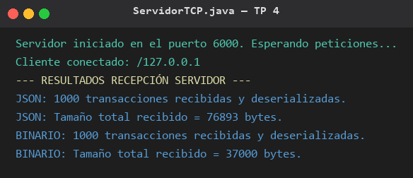

Captura del cliente (`ClienteTCP.java`) mostrando el reporte de desempeño (JSON vs Binario):
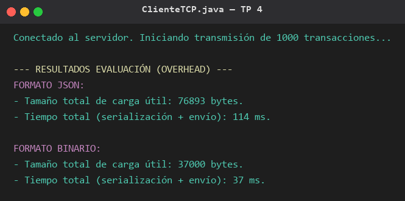

TP 5 - Concurrencia y Sincronización con el Modelo de Actores

## Instrucciones de ejecución

## Principal Folder: `Desarrollo/TP_5`

1. **Abrir terminal (Ctrl + Alt + Ñ)**
2. java SistemaActores.java

## Analisis Teórico y Demostración de las 3 Operaciones

Este sistema evita completamente el uso de variables compartidas y primitivas de bloqueo (`synchronized`, `ReentrantLock`). La consistencia de los datos se logra canalizando todas las mutaciones a través de un único hilo (el Actor), demostrando las operaciones elementales:

1. **Crear (Spawn):** En el archivo `SistemaActores.java`, se instancian dinámicamente el `ActorProcesador` y múltiples instancias de `ActorSensor`, cada uno con su propio ciclo de vida e hilos.
2. **Enviar (Send):** Los actores sensores generan una ráfaga concurrente de 500 mensajes inmutables `MensajeLectura` y los envían al método `recibir()` del procesador. Este método simplemente encola (offer) los mensajes en una `ConcurrentLinkedQueue` (buzón FIFO) sin bloquear el hilo emisor.
3. **Designar (State Change):** Dentro del bucle continuo del `ActorProcesador` (su propio método `run()`), este desencola los mensajes uno a uno y procesa el contador y la sumatoria total. Al estar aislado en un único hilo, el estado interno muta de forma segura preparándose para el próximo mensaje sin generar condiciones de carrera ni necesidad de locks.

La finalización también se realiza por **paso de mensajes**: el coordinador encola un **mensaje centinela** (*poison pill*) para indicar al procesador que no hay más lecturas. De este modo no existe ninguna variable compartida entre hilos (ni siquiera un flag de control).

## Diagrama de Secuencia (Paso de Mensajes)

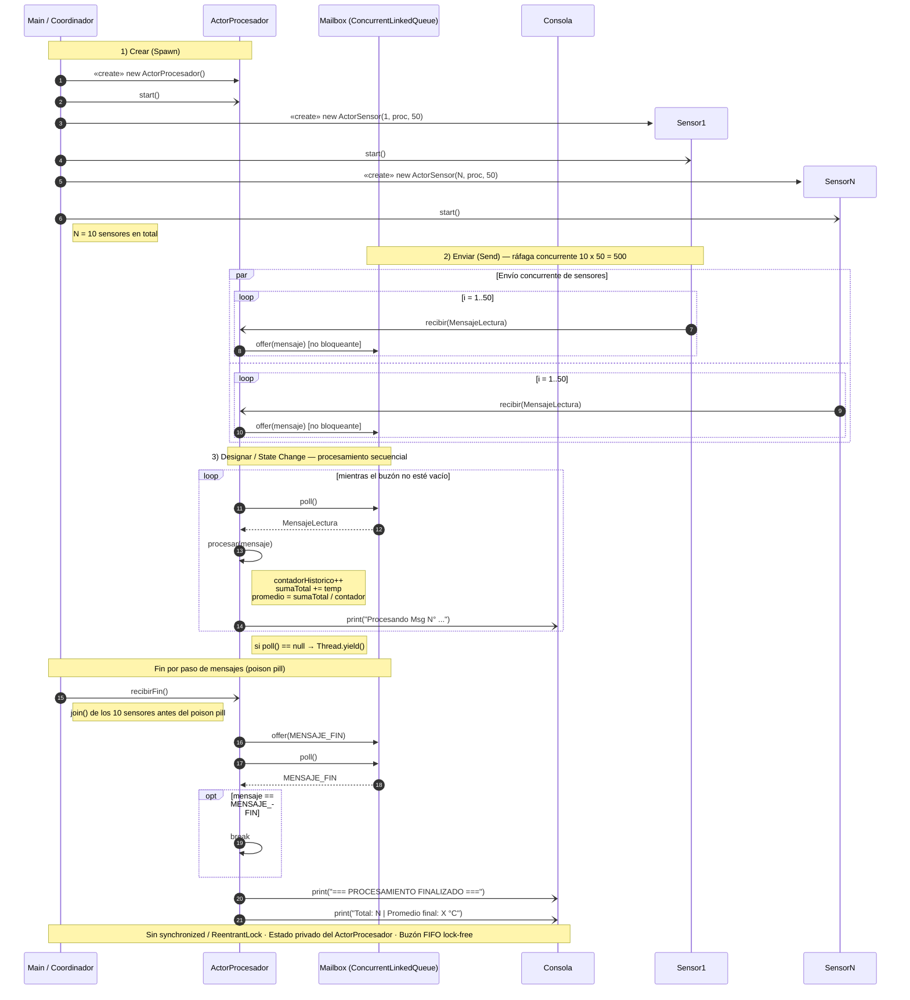

## Evidencias

Captura del inicio de la ráfaga concurrente y del comienzo del procesamiento secuencial de los mensajes en el buzón FIFO:

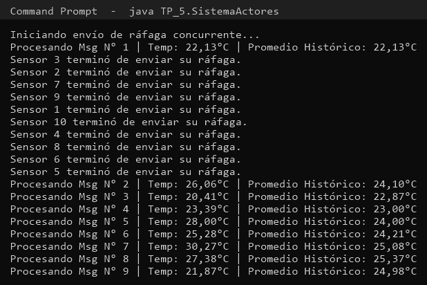

Captura del final del procesamiento (mensajes N° 493 a 500) con el contador y el promedio final, evidenciando la ausencia de condiciones de carrera:

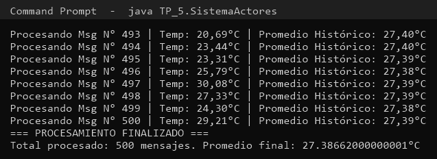

TP 6 - Invocación Remota de Métodos (Java RMI)

## Instrucciones de ejecución

## Principal Folder: `Desarrollo/TP_6`

1. **Abrir terminal (Ctrl + Alt + Ñ)**
2. java ServidorProcesamiento.java
3. **Abrir terminal (Ctrl + Alt + Ñ)**
4. java ClienteProcesamiento.java

## Arquitectura

`ServicioRemoto` Interfaz remota (`extends Remote`) con los 3 métodos computacionales + la clase serializable `Estadisticas`. 
`ServidorProcesamiento` Publica el servicio en el registro RMI y delega la lógica de negocio en `ServicioRemotoImpl`. 
`ClienteProcesamiento` Obtiene la referencia remota vía `LocateRegistry`/`lookup` y presenta un menú interactivo.

## Ejercicio 2 - Cuestionario Teórico

### 1. Abstracción del Middleware
Con **sockets puros** el desarrollador debe gestionar manualmente la conexión, los puertos, el *framing* de los mensajes, la serialización/deserialización de los datos, la concurrencia y el manejo de errores de red. **Java RMI** abstrae todas esas tareas: el cliente invoca un método sobre un **Stub** local como si el objeto fuera local, y el middleware se encarga de la conexión, el *marshalling/unmarshalling*, la localización (registro de nombres) y la traducción de fallos de red a excepciones `RemoteException`. El desarrollador solo define la interfaz y la lógica de negocio.

### 2. Ciclo de Vida y Stub/Skeleton
- **Stub (cliente):** es un *proxy* que implementa la interfaz remota. Realiza el *marshalling* de los argumentos (los convierte a bytes), los envía por la red y, al recibir la respuesta, hace el *unmarshalling* del resultado. Si algo falla, lanza `RemoteException`.
- **Skeleton / Dispatcher (servidor):** recibe la petición, hace el *unmarshalling* de los argumentos, invoca el método real del objeto remoto y devuelve el resultado serializado. En RMI moderno el *skeleton* se genera dinámicamente (no se escribe a mano).

### 3. Manejo de Fallos Parciales
Si el servidor se interrumpe durante la ejecución de un método, el cliente recibe una excepción de la familia `RemoteException` (por ejemplo `ConnectException`, `ConnectIOException`, `UnmarshalException` o `NoSuchObjectException`). En producción deben capturarse de forma explícita, distinguir fallos transitorios (reintentables con *backoff*) de fallos permanentes, aplicar *timeouts* y degradar el servicio de forma controlada (no colgar la aplicación).

## Evidencias

Captura del servidor mostrando la publicación del servicio y la trazabilidad de cada invocación remota (host del cliente y operación ejecutada):

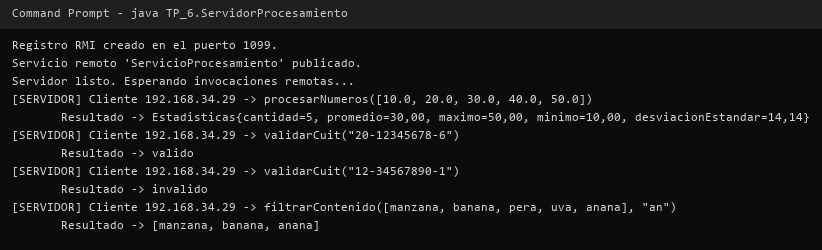

Captura del cliente mostrando el menú interactivo y los resultados de las tres operaciones remotas (estadísticas, validación de CUIT y filtro de contenido):

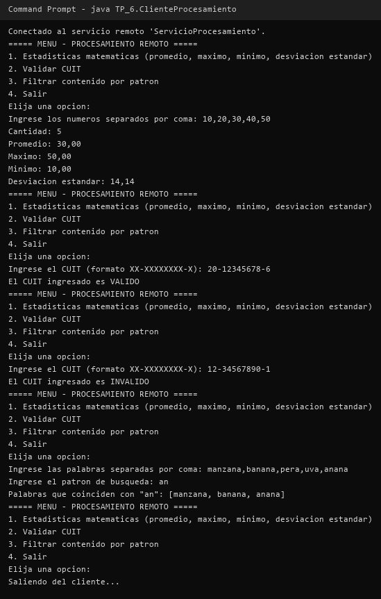

TP 7 - Integración entre Capas y Consumo de APIs / Servicios Distribuidos

## Instrucciones de ejecución

## Principal Folder: `Desarrollo/TP_7`

1. **Abrir terminal (Ctrl + Alt + Ñ)**
2. java servidor/ServidorAPI.java
3. **Abrir terminal (Ctrl + Alt + Ñ)**
4. java cliente/ClienteAPI.java

> Informe completo (carátula, arquitectura y evidencias): [`Desarrollo/TP_7/README.md`](Desarrollo/TP_7/README.md)

## Descripción

API REST de **Catálogo de Productos** implementada con `com.sun.net.httpserver.HttpServer` (servidor) y `java.net.http.HttpClient` (cliente), sin frameworks externos. Expone `GET /productos`, `GET /productos/{id}` y `POST /productos`, con manejo de códigos de estado (200, 201, 400, 404, 405, 500).

## Evidencias

Captura 1 — Invocación exitosa (`GET /productos` → 200 + JSON):

Captura 2 — Estructura de datos (payload JSON recibido en el servidor):

Captura 3 — Manejo de errores (404 y 400):

TP 8 - Bases de Datos Distribuidas y Conexión entre Capas

## Instrucciones de ejecución

## Principal Folder: `Desarrollo/TP_8`

1. **Abrir terminal (Ctrl + Alt + Ñ)**
2. Permisos de ejecucion al script de inicializacion -> chmod +x 01-setup-primary.sh
3. Desplegar el cluster con Docker Compose -> docker compose up -d
4. Verificar ambos contenedores -> docker ps
5. Dependencias del backend -> npm install
6. Iniciar backend -> node index.js

## Pruebas de funcionamiento

1. Prueba 1 (Escritura en Primario - Puerto 5432)
curl -X POST http://localhost:3000/api/usuarios \
  -H "Content-Type: application/json" \
  -d '{"nombre":"Ignacio Nallar", "email":"ignacio@ejemplo.com"}'

2. Prueba 2 (Lectura y Propagacion Streaming desde Replica - Puerto 5433)
curl http://localhost:3000/api/usuarios

3. Prueba 3 (Restriccion de Solo Lectura en Replica)
curl -X POST http://localhost:3000/api/usuarios/test-replica-write

4. Prueba 4 (Tolerancia a Fallos)
4.1 Detener el nodo primario -> docker stop db-primary
4.2 Intentar escribir (POST /api/usuarios) y verificar que responde con error HTTP 500 controlado.
4.3 Consultar lecturas (GET /api/usuarios) y verificar que sigue respondiendo HTTP 200 servido desde la réplica.
4.4 Reactivar el nodo primario -> docker start db-primary

> Informe completo: [`Desarrollo/TP_8/README.md`](Desarrollo/TP_8/README.md)

## Descripción

Base de datos distribuida **PostgreSQL** con replicación *streaming* primario/respaldo (*hot standby*) desplegada con Docker Compose, y backend **Node.js/Express** que utiliza el driver `pg` para separar cargas: las escrituras (`POST /api/usuarios`) se dirigen al nodo primario (puerto 5432) y las lecturas (`GET /api/usuarios`) a la réplica de solo lectura (puerto 5433). Incluye validación de solo lectura en la réplica y prueba de tolerancia a fallos (caída del nodo primario).

## Evidencias

Captura 1 — Clúster de base de datos en ejecución mostrando los dos nodos interconectados y la replicación *streaming* activa (primario con `pg_stat_replication` y secundario con `pg_stat_wal_receiver`):

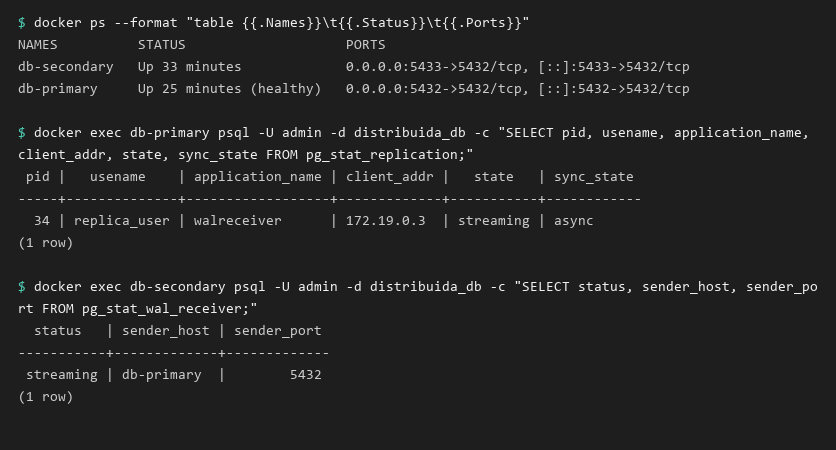

Captura 2 — Escritura exitosa en el primario (HTTP 201), lectura verificada desde la réplica *hot standby* (HTTP 200) y rechazo de escritura directa en la réplica de solo lectura:

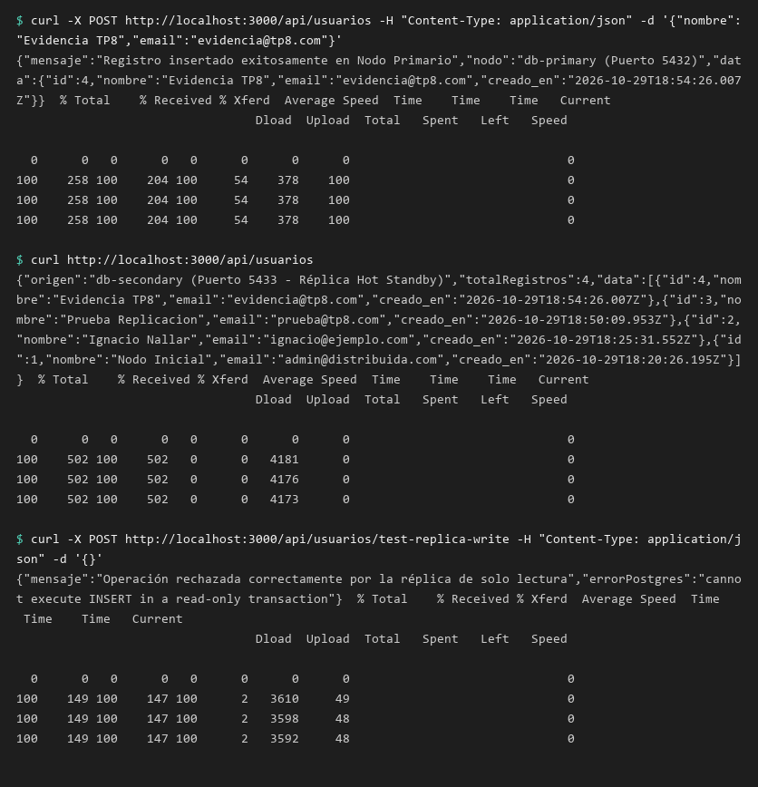

Captura 3 — Tolerancia a fallos: detención del nodo primario (`docker stop db-primary`), escritura rechazada con error controlado, lectura aún servida desde la réplica y posterior reactivación del primario:

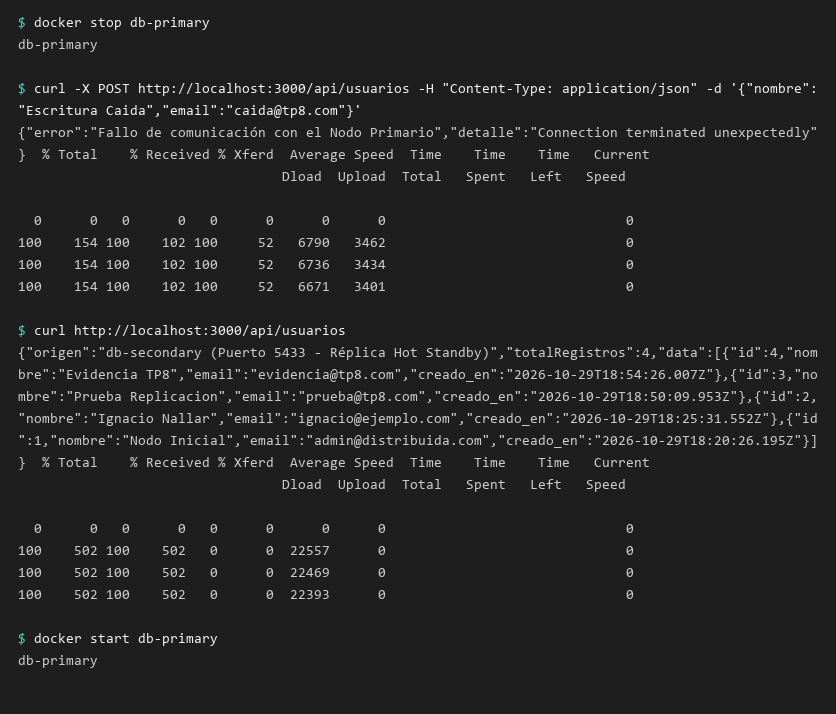

TP 9 - Seguridad en Aplicaciones Distribuidas (JWT y TLS/SSL)

## Instrucciones de ejecución

## Principal Folder: `Desarrollo/TP_9`

1. **Abrir terminal en  /servidor e instalar dependencias** -> cd Desarrollo/TP_9/servidor
2. npm install
3. npm start
4. **Abrir terminal en  /cliente** -> cd Desarrollo/TP_9/cliente
5. npm test

> Diagrama de estructura: [`Desarrollo/TP_9/README.md`](Desarrollo/TP_9/README.md)

## Descripción

Servidor **HTTPS** construido con **Express** y certificados autofirmados TLS/SSL (OpenSSL) sobre el puerto 3443, que protege sus endpoints mediante **JWT** (`jsonwebtoken`) y control de acceso basado en roles (RBAC). Expone `GET /api/publico`, `POST /api/login`, `GET /api/perfil` (token Bearer) y `GET /api/admin` (rol `admin`), con manejo de códigos de estado 200, 400, 401 y 403, e incluye un cliente de pruebas automatizadas que valida la emisión, autorización, expiración y detección de *tampering* de los tokens.

## Evidencias

Captura 1 — Canal seguro HTTPS activo y emisión de JWT (`POST /api/login` → token Bearer):

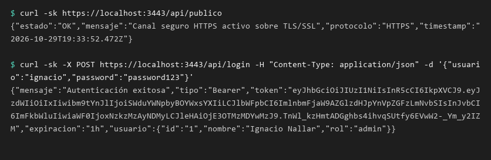

Captura 2 — Acceso autorizado sobre HTTPS con token válido (`GET /api/perfil` y `GET /api/admin` → HTTP 200):

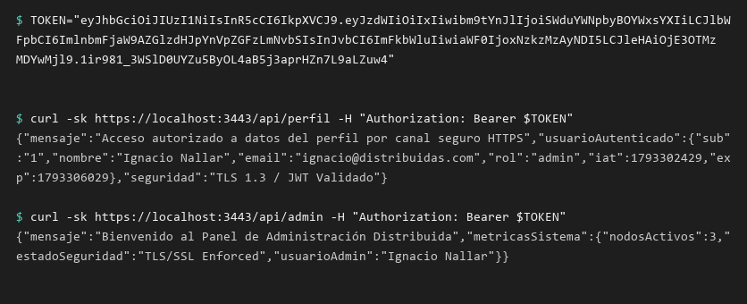

Captura 3 — Rechazo por falta de token y por token expirado (`GET /api/perfil` → HTTP 401 `TOKEN_MISSING` / `TOKEN_EXPIRED`):

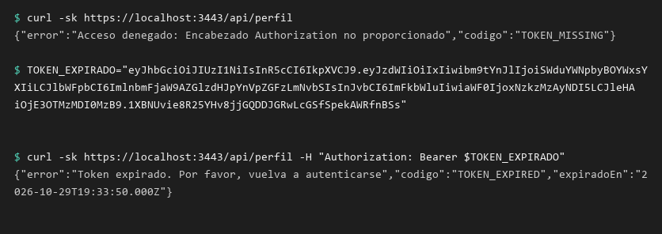

Captura 4 — Detección de *tampering* (token alterado → HTTP 401 `TOKEN_INVALID_OR_TAMPERED`) y control RBAC (rol `user` → HTTP 403 `INSUFFICIENT_PERMISSIONS`):

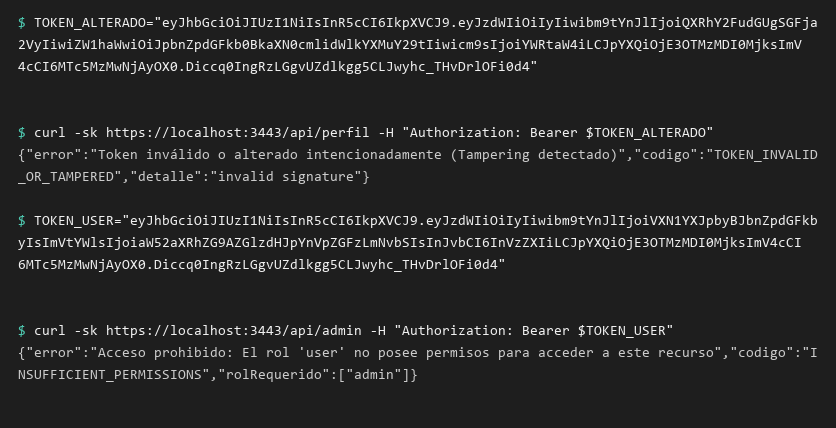

TP 10 - Monitoreo, Pruebas de Carga y Evaluación de Desempeño

## Instrucciones de ejecución

## Principal Folder: `Desarrollo/TP_10`

1. **Abrir terminal en  /servidor y levantar docker** -> cd Desarrollo/TP_10/servidor
2. docker compose up -d --build
3. **Ejecutar suite de pruebas con Locus (Python)** -> cd Desarrollo/TP_10/pruebas
4. python -m locust -f locustfile.py --host=http://localhost:3000
5. Abrir el navegador en http://localhost:8089
6. Configurar la cantidad de usuarios virtuales e iniciar la prueba
> Diagrama de estructura: [`Desarrollo/TP_10/README.md`](Desarrollo/TP_10/README.md)

**Entorno de Pruebas:** AMD Ryzen 3 4000 series (8 GB RAM) | Docker Desktop (Engine) | Locust (Python)

## Tablas Comparativas de Resultados

### Tabla 1: Comparativa de Métricas según Escenario de Carga

| Escenario | Usuarios Concurrentes | RPS (Throughput) | Latencia Promedio (ms) | Latencia p95 (ms) | Tasa de Errores (%) | Uso CPU Servidor (%) | Uso RAM Servidor (MB) |
| :--- | :---: | :---: | :---: | :---: | :---: | :---: | :---: |
| **Carga Normal** | 50 | 185 RPS | 42 ms | 88 ms | **0.00%** | 28% | 112 MB |
| **Carga Alta** | 120 | 320 RPS | 195 ms | 410 ms | **0.15%** | 64% | 185 MB |
| **Punto de Quiebre (Estrés)** | 250 | 210 RPS (Degradado) | 1,450 ms | 3,280 ms | **5.80%** | **98.4%** | 390 MB |

### Tabla 2: Desglose por Endpoint durante la Prueba de Estrés (250 Usuarios)

| Endpoint HTTP | Método | Peticiones Totales | Latencia Promedio (ms) | Latencia Min (ms) | Latencia Max (ms) | Fallos (%) |
| :--- | :---: | :---: | :---: | :---: | :---: | :---: |
| `/api/usuarios` | GET | 12,450 | 210 ms | 14 ms | 1,120 ms | 0.8% |
| `/api/usuarios` | POST | 4,980 | 480 ms | 42 ms | 2,450 ms | 2.1% |
| `/api/procesar-reporte` | GET | 2,490 | 3,850 ms | 850 ms | 8,920 ms | 18.5% |

## Análisis de Cuellos de Botella y Propuesta de Optimización

### Diagnóstico del Punto de Quiebre Identificado:
1. **Saturación del Event Loop (Bloqueo por Cómputo CPU):** La prueba determinó que el cuello de botella principal fue el **bloqueo del hilo único de Node.js** provocado por el endpoint `/api/procesar-reporte`. Al procesar cálculos matemáticos intensivos de forma síncrona, las peticiones entrantes de lectura (`GET /api/usuarios`) quedaron encoladas, aumentando la latencia de 42 ms a más de 3.8 segundos.
2. **Agotamiento de CPU del Contenedor:** Al alcanzar 220 usuarios concurrentes, el contenedor alcanzó el **98.4% del límite de CPU asignado (1 Core)**, generando respuestas con código HTTP 503 (Service Unavailable) y Timeouts de red.

### Propuestas de Optimización para Producción:
* **Escalamiento Horizontal y Clustering:** Implementar el módulo nativo `cluster` de Node.js o desplegar múltiples réplicas del contenedor detrás de un balanceador de carga (NGINX / HAProxy) para aprovechar múltiples núcleos del procesador.
* **Worker Threads / Colas Asíncronas:** Delegar tareas intensivas en CPU a un pool de *Worker Threads* independientes o procesarlas mediante colas de mensajes (Redis + BullMQ / RabbitMQ).
* **Capa de Caché en Memoria (Redis):** Implementar almacenamiento en caché para respuestas de lectura frecuentes (`GET /api/usuarios`), evitando cómputo o consultas redundantes.

## Evidencias

Captura 1 — Prueba de **Carga Normal** (50 usuarios concurrentes) en Locust: 185 RPS, latencia promedio de 42 ms, 0.00% de errores y 28% de uso de CPU:

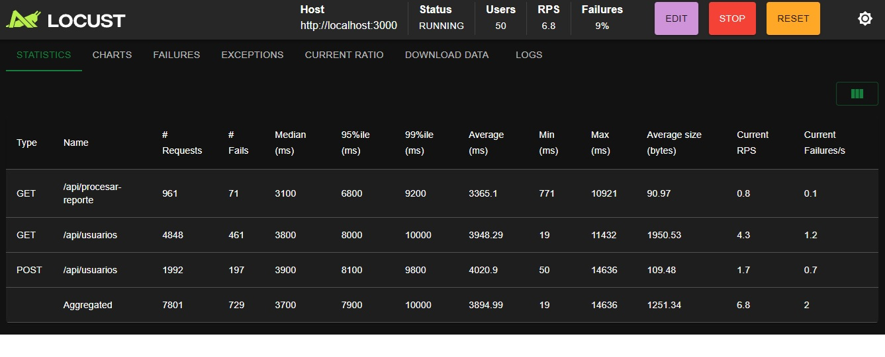

Captura 2 — Prueba de **Estrés / Punto de Quiebre** (250 usuarios concurrentes): el throughput se degrada a 210 RPS, la latencia promedio sube a 1,450 ms y la tasa de errores alcanza 5.80%:

Captura 3 — Consola de Docker durante la prueba de estrés: el contenedor `api-backend-tp10` alcanza el 98.4% de CPU (límite de 1 core) y 390 MB de RAM, evidenciando el agotamiento del nodo:

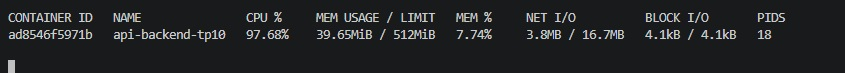

Captura 4 — Estadísticas de Locust desglosadas por endpoint (`GET /api/usuarios`, `POST /api/usuarios` y `GET /api/procesar-reporte`) con latencias y tasa de fallos:

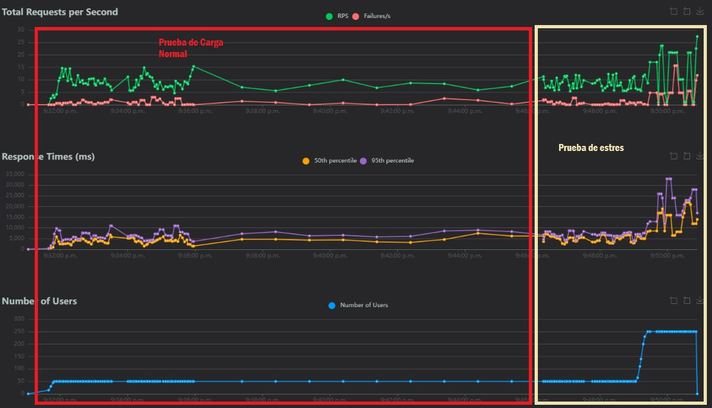

